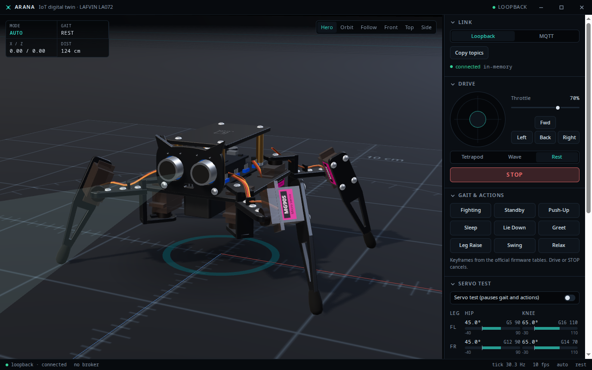
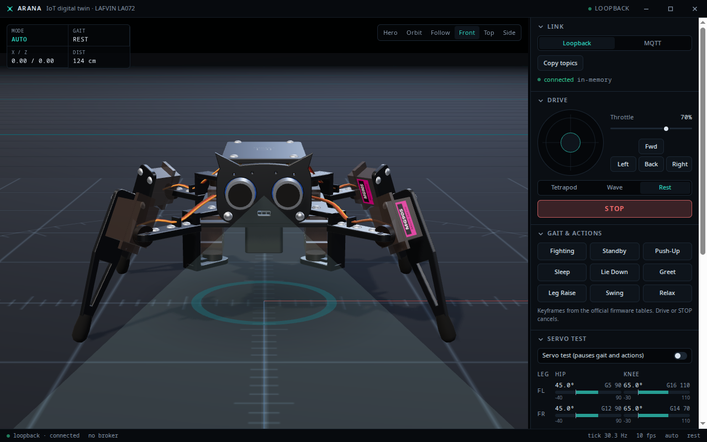
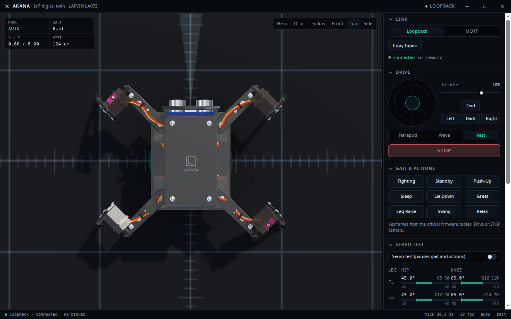
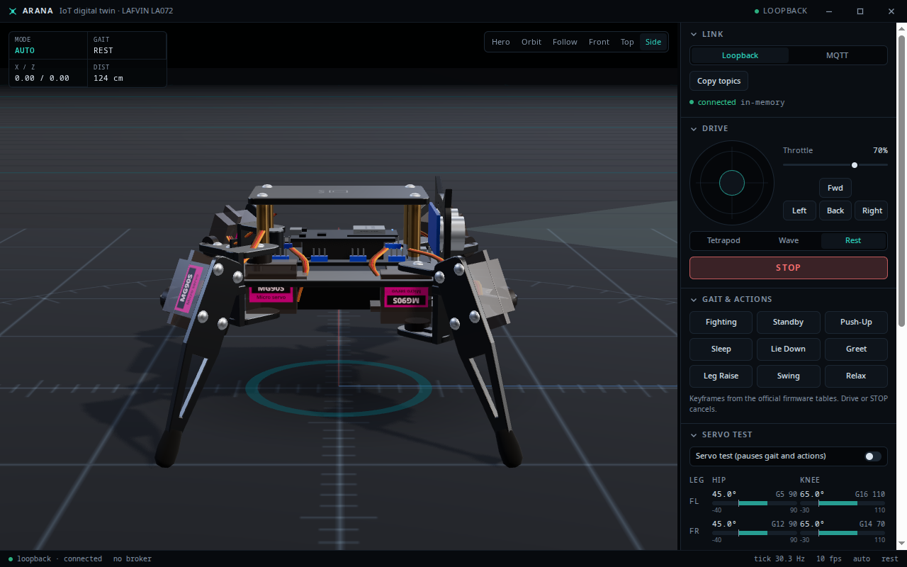

# arana-iot

Digital twin, test bench and controller for the **LAFVIN LA072** quadruped spider robot
(ESP8266, 8 × MG90S, HC-SR04, IR receiver) used in the TI3042 IoT course.

The twin speaks the **same MQTT protocol** the physical kit will speak, so swapping the
simulated body for the real one changes only the transport target, not the code. The physical
robot is not assembled yet: everything you see is the twin.



## What it is

- **Hardware-faithful model.** Two MG90S per leg (hip yaw + knee pitch) with a passive
  horizontal femur, built from the kit's photos, manual and official firmware
  (`docs/reference/`, `odd/tasks/desktop-experience.md` has the evidence log).
- **One kinematic truth.** `src/sim/legKinematics.ts` is used by the engine and the renderer;
  a test proves the rendered foot tips equal the solver's feet.
- **Physical walking without a physics engine.** The body rests on the feet that touch the
  floor and planted feet do not slip; forward motion, turning and the "body turn" of the
  Fighting action all emerge from the legs.
- **The nine preset actions** (Fighting, Standby, Push-Up, Sleep, Lie Down, Greet, Leg Raise,
  Swing, Relax) are the official firmware keyframe tables, played the way the firmware plays
  them.
- **Test bench.** 12 × 12 m arena, 10 cm / 1 m grid, 1 m calibration mat, distance markers to
  4 m, box / cylinder / low wall, collisions, HC-SR04 cone and hit point.
- **Instrument UI.** Link, drive, gait & actions, servo test (with the firmware GPIO and raw
  servo degree per joint), telemetry, packet log.

## Run

```bash
npm ci
npm run dev             # browser, http://localhost:5173 (the PWA build is the same app)
npm run desktop         # Vite + Electron (frameless window, custom titlebar)
npm run desktop:build   # production renderer in dist-desktop/ (works offline)
npm run desktop:start   # run Electron on dist-desktop/
npm run desktop:shots   # writes docs/screenshots/{hero,front,top,side}.png (xvfb-run if headless)
npm run broker          # local MQTT broker (aedes): TCP 1883, WebSocket 9001
npm test                # Vitest (sim, kinematics, actions, protocol, Electron helpers)
npm run lint            # oxlint
```

Real-broker check (skipped by default; credentials only from the environment):

```bash
ARANA_BROKER_URL=ws://localhost:9001/mqtt ARANA_BROKER_USER=... ARANA_BROKER_PASS=... \
  npx vitest run src/net/mqtt.integration.test.ts
```

Extra screenshot variables: `ARANA_SHOTS=<dir>` output folder, `ARANA_SHOTS_SIZE=960x640`
window size, `ARANA_SHOTS_EXTRA=1` also captures walking, Greet and Lie Down.

## Controls

| Input | Action |
| --- | --- |
| Joystick / W A S D | drive (up = forward, right = turn right) |
| Throttle slider, Shift | scale the command; Shift holds 100 % |
| Space / STOP | stop and cancel any action |
| 1 / 2 / 3 | tetrapod / wave / rest |
| F / O | follow / orbit camera (Hero, Front, Top, Side presets in the toolbar) |
| R | reset pose and position |
| ? | keyboard help |

Driving switches the body to `manual`; 5 s without operator commands returns it to `auto`.
The servo test mode drives the eight joints from sliders, locally only: nothing is sent to
hardware.

## Architecture

```
src/protocol.ts          message contract shared by twin / brain / ESP / Android
src/sim/spiderModel.ts   SPIDER dimensions, leg configs, neutral pose (single source)
src/sim/legKinematics.ts 2-DOF leg FK / IK
src/sim/servoMap.ts      twin joints <-> official firmware servo degrees
src/sim/gait.ts          tetrapod / wave planner (body frame)
src/sim/bodyPose.ts      support fit + planted-feet planar fit
src/sim/actions.ts       the nine firmware actions and their player
src/sim/world.ts         colliders, collision, sonar ray
src/sim/engine.ts        headless engine: commands -> joints -> body pose
src/net/transport.ts     Loopback | MQTT (same interface)
src/runtime/             engine + transport at 30 Hz, React store at 10 Hz, packet log
src/scene/               Three.js: spider mesh, arena, view (interpolated, one render loop)
src/ui/                  titlebar, panels, joystick, status bar
electron/                main (IPC, window state, CSP), sandboxed preload, window helpers
```

The engine owns all state. React only subscribes and draws; the 3D view reads the engine per
tick and never re-renders React per frame.

## Protocol

Topics `arana/cmd`, `arana/telemetry`, `arana/brain/state`, `arana/brain/stimulus`; JSON, QoS 0.
Commands: `move`, `stop`, `gait`, `mode`, `pose`. Telemetry carries pose, sonar distance, gait,
mode and 8 joint angles (FL, FR, RL, RR × hip, knee). Full contract and firmware mapping:
[`docs/protocol.md`](docs/protocol.md).

## Remote control

The broker for the phone app and the desktop twin is Mosquitto on the T420
(LAN `ws://192.168.1.79:9001/mqtt`, Tailscale `ws://100.66.97.18:9001/mqtt`). Exposing it
through the existing Cloudflare tunnel and the Android handoff are described in
[`docs/remote-control.md`](docs/remote-control.md).

## Android command center

The native Kotlin app in [`android/`](android/) is the field controller. The desktop Electron
app remains the 3D body and test bench; the phone has a 2D tactical map, a joystick, the nine
firmware actions, live servo angles and the packet log.

### Build and install

```bash
cd android
ANDROID_HOME=/home/iwakura/Android/Sdk ./gradlew test lintDebug assembleDebug
adb install -r app/build/outputs/apk/debug/app-debug.apk
```

A prebuilt debug APK is committed at
[`android/arana-command-center-0.2.0-debug.apk`](android/arana-command-center-0.2.0-debug.apk).
The full acceptance script is in [`docs/android-demo.md`](docs/android-demo.md).

### Login

The first screen is the only login. It authenticates directly against the T420 Mosquitto
broker; there is no local account database and no separate connection screen.

| Field | Default |
| --- | --- |
| Server URL | `wss://mqtt.t420.dev/mqtt` |
| Username | `conectoma` |
| Password | `cont1234` |

These are **test credentials for the classroom demo**, explicitly requested by the project
owner. They are public in this repository; do not reuse them outside this demo. The remembered
copy is stored with `EncryptedSharedPreferences`.

At the time of this commit `mqtt.t420.dev` is **not yet provisioned** in the Cloudflare tunnel.
The default URL therefore fails with “Cannot reach the server”. Until the tunnel step in
[`docs/remote-control.md`](docs/remote-control.md) is done, edit the Server URL to the LAN or
Tailscale address above. Debug builds allow cleartext for those two addresses; release builds
keep TLS on.

### Electron body preflight

The phone can only control the Electron twin when both are connected to the **same broker**.
The phone does not launch Electron.

1. Open the Electron app and switch its Link panel from Loopback to MQTT.
2. Enter the same server URL, username and password, then Connect.
3. Confirm that telemetry is moving in the desktop app.
4. Connect the phone. If no telemetry arrives, the Console shows
   `NO TELEMETRY — connect the Electron body to the same broker.` instead of pretending the
   controls work.

### EVA2 mapping

| Requirement | Where |
| --- | --- |
| Real login | MQTT CONNECT against Mosquitto; the app waits for CONNACK and stays on Login on failure |
| Monitoring | Console telemetry cards, tactical map, packet log |
| Activator | Joystick, throttle `Slider`, gait `RadioButton`s, auto/manual `Switch`, nine actions |
| Two instances | Body Mode (demo) on one device + Console on another, both on the same broker |
| Security | TLS default, encrypted remembered credentials, no password in logs or Intents, test-password warning |

## Screenshots

| Hero | Front | Top | Side |
| --- | --- | --- | --- |
|  |  |  |  |

## Limitations

- The physical kit is not assembled; link lengths are derived from photos (no official
  dimensions exist) and per-robot servo trim (`Servo_Offset`) is not modeled.
- 2-DOF legs cannot choose foot height: swing feet land within ~2–3 mm of the floor and the
  body rocks a few degrees while walking. That is the kit's geometry, not a bug.
- The brain bridge is an extension point only: in `auto` with no brain the body stays idle.
- No installer: `dist-desktop/` + `npm run desktop:start` is the desktop deliverable.
- The ESP firmware does not speak MQTT yet; `pose` is an additive command it may ignore.
